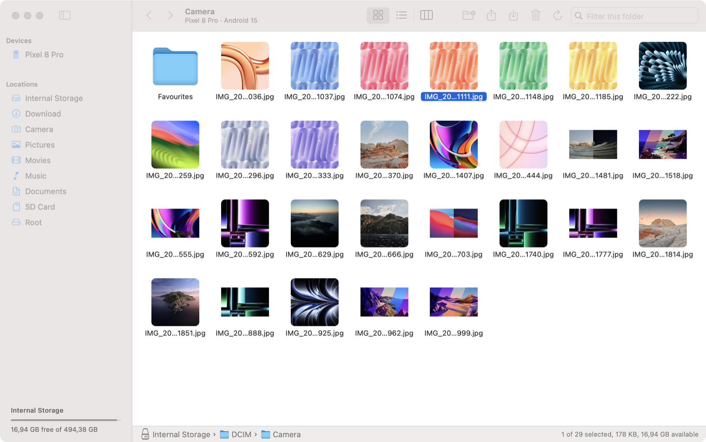
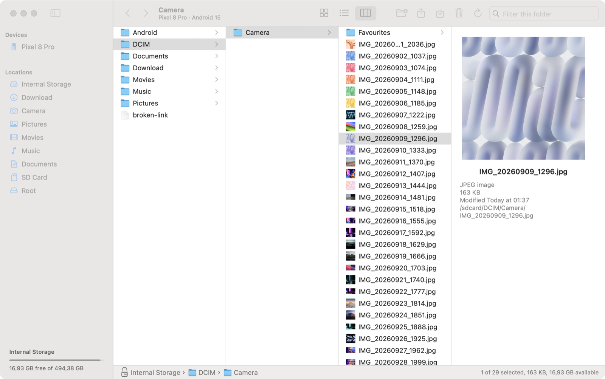

<p align="center">
  
</p>

<h1 align="center">ADB Finder</h1>

<p align="center">
  A native macOS file manager for Android phones, built on <code>adb</code>.<br>
  Browse the phone like a Finder window and drag files both ways — no Android File Transfer, no MTP, no cloud.
</p>

<p align="center">
  
</p>

<p align="center">
  
</p>

## Why

Android File Transfer is discontinued and was never reliable; MTP on macOS is worse — other apps grab the connection, big files fail, folders take ages to "index". ADB is fast and rock solid, it just has no UI. Other ADB file managers exist, but they are Windows apps, Electron wrappers or terminal tools. ADB Finder is a real Mac app: one small native binary that looks and behaves like Finder.

## Features

- **Finder-style browser**: sidebar with devices and places (Internal Storage, Download, Camera, Pictures, Movies, Music, Documents, SD card, Root), path bar, Back/Forward, filter field, hidden files toggle
- **Three views, like Finder**: Icons (⌘1), List (⌘2) with sortable name, date, size and kind columns, and Columns (⌘3) with a preview pane for the selected file
- **Photo, video and PDF previews** right in the icons, list and columns — a screenful of camera photos appears in about half a second, even in a folder with thousands of files. Only what is on screen is fetched, and previews are kept on the Mac (never on the phone) so the next visit is instant
- **Folders show how many items they hold**, in every view
- **Drag and drop copies, both ways**: drag files or folders from the phone straight to the Desktop or any Finder window, or drop Mac files onto the window — onto a folder to put them inside it, or onto a place in the sidebar. Drops from Photos and Mail work too
- **Copy on the device** by dragging items onto another folder. Nothing is ever moved: the originals always stay where they were
- **Everyday file operations**: New Folder (⇧⌘N), inline Rename (Return), Duplicate (⌘D), Delete (⌘⌫, with confirmation), Copy (⌘C) and Paste (⌘V) between folders on the phone, Copy Path, Download to Mac…, Upload…, and ⌘V to upload files copied in Finder
- **Quick Look** (Space) for files and folders — a folder gets the same preview as in Finder, with its size and item count — and **Open** (double-click) in the default Mac app
- **Get Info** (⌘I): kind, exact size, location, dates and permissions; folder size and contents; photo dimensions, camera and date taken; video resolution and duration
- **Sort By** name, kind, date or size (⌃⌥⌘1–4), in every view
- **Install APKs** by dropping them onto the window
- **Photos show up in Gallery right away**: the media scanner is notified after uploads, copies, renames and deletes
- **Real progress**: bytes, speed and time left, Dock badge, Stop button; transfers dropped while another one runs are queued
- **Asks before overwriting** files that already exist in the target folder (Replace / Skip)
- **Keeps dates**: files copied to the Mac keep their modification time
- **Reliable on big libraries** (the engine from Android Drop): failed pushes are retried, a disconnected phone stops the transfer cleanly, *Retry Failed* resends only what didn't make it, and *Show Last Transfer* (⌥⌘R) lists every file with its destination and ADB error
- **Handles awkward names** — spaces, Cyrillic, emoji, quotes and parentheses; Finder litter (`.DS_Store`, `._*`) is never copied
- **Right-click the phone** in the sidebar for **Device Info** (model, Android and security patch, build, kernel, processor, memory, screen, battery, storage, Wi-Fi IP, uptime, root — with Copy All), **Take Screenshot** (saved to the Desktop like a Mac screenshot), **Install APK…**, **Open Shell in Terminal**, **Connect over Wi-Fi** (or Disconnect / Forget), **Restart** (normal, recovery, bootloader) and copying the serial number or model
- **Multiple devices** in the sidebar, shown by the name you gave the phone (*Kreal's Honor*) and its model; clear messages when the phone is unauthorized, offline, or adb is missing
- Native Cocoa in a single Objective-C file, universal (Apple Silicon + Intel), no dependencies besides `adb`

## Requirements

- macOS 12 Monterey or later
- `adb` from Android Platform Tools:

  ```bash
  brew install android-platform-tools
  ```

  The app looks for it in `/opt/homebrew/bin`, `/usr/local/bin`, `~/Library/Android/sdk/platform-tools`, `$ANDROID_HOME`, `$PATH` and `/usr/bin`. Set `ADB_FINDER_ADB` to use a specific binary.
- A phone with **USB debugging** enabled: *Settings → About phone →* tap *Build number* seven times, then *Settings → System → Developer options → USB debugging*. Accept the "Allow USB debugging?" prompt the first time you connect.

Wireless debugging works too — anything that shows up in `adb devices` does.

**Wi-Fi without the cable:** right-click the phone (connected by USB) → **Connect over Wi-Fi**. ADB Finder remembers it: when the Mac wakes up or adb restarts, it reconnects on its own, and while the phone is out of reach it stays in the sidebar, greyed out (right-click → Reconnect or Forget). The phone keeps Wi-Fi debugging on until it restarts; after a restart, connect it by USB and choose Connect over Wi-Fi once more.

## Install

Grab `ADB-Finder-v1.0.0.zip` from [Releases](../../releases), unzip and move **ADB Finder.app** to `/Applications`.

The build is not notarized, so on first launch right-click the app → **Open**, or clear the quarantine flag:

```bash
xattr -dr com.apple.quarantine "/Applications/ADB Finder.app"
```

## Build from source

Needs only the Xcode Command Line Tools (`xcode-select --install`):

```bash
git clone https://github.com/Kreal-exe/ADB-Finder.git
cd ADB-Finder
./build.command
```

The script compiles `ADBFinder/main.m` with `clang`, generates the `.icns` from `AppIcon.png`, signs the app ad hoc and installs **ADB Finder.app** into `/Applications`. If the app is running, it is quit first and reopened after the update. `./build.command --zip` also writes `dist/ADB-Finder-v1.0.0.zip` for a release; `INSTALL_DIR=~/Applications ./build.command` installs elsewhere. The icon itself is drawn by `tools/make-icon.swift`.

## Keyboard shortcuts

| Action | Keys |
| --- | --- |
| Icons / List / Columns | ⌘1 / ⌘2 / ⌘3 |
| Open folder / file | Double-click, ⌘↓ |
| Enclosing folder | ⌘↑ |
| Back / Forward | ⌘[ / ⌘] |
| Quick Look | Space, ⌘Y |
| Get Info | ⌘I |
| Duplicate | ⌘D |
| Copy / Paste | ⌘C / ⌘V |
| Sort by name, kind, date, size | ⌃⌥⌘1–4 |
| Rename | Return |
| New Folder | ⇧⌘N |
| Delete | ⌘⌫ |
| Upload / Download | ⇧⌘U / ⇧⌘D |
| Go to Folder | ⇧⌘G |
| Internal Storage, Download, Camera, Documents | ⇧⌘H, ⇧⌘L, ⇧⌘C, ⇧⌘O |
| Show hidden files | ⇧⌘. |
| Refresh | ⌘R |
| Filter this folder | ⌘F |

## How it works

- A folder is listed with a single `adb shell` call: `find` + `stat -L` print type, size and date for every entry (falling back to `ls -p` on very old devices). `/` separates the fields, since it can't appear in a file name.
- Mac → phone uses `adb push`, one file at a time, with folders created in a few batched `mkdir -p` calls; progress for big files comes from polling the file size on the device.
- Previews are made on the Mac from as few bytes as possible, read with `adb exec-out`:
  - **JPEG photos**: the small preview embedded in the EXIF block, from the first 72 KB of the file. Sixteen photos at a time are read in one adb call.
  - **Videos**: the index (`moov`, usually a few KB) and the first frame only — the app walks the MP4 boxes and reads those byte ranges with `dd` — about 0.3 MB instead of the whole file. AVFoundation decodes the frame from a sparse local copy.
  - **PDFs and other images** (PNG, HEIC, screenshots) are read whole, up to 40 / 30 MB.
  - Android's own thumbnail store was measured and is slower: each `content read` starts a Java process on the phone (~1.2 s per picture).
- Previews live in `~/Library/Caches/ADBFinder/Thumbnails/<device>/`. A phone's previews are deleted when it hasn't been connected for 30 days, and the whole cache is kept under 1 GB. Nothing is written to the phone.
- Folder item counts come from one shell loop per folder; folder sizes from `du` and `find` when you ask for them (Quick Look or Get Info).
- Copies inside the phone run `cp -R` on the device, so nothing goes through the Mac.
- Phone → Mac uses `adb pull -a`. Dragging to Finder is a file promise (`NSFilePromiseProvider`), so the copy starts only when you drop.
- Every path sent through `adb shell` is single-quoted, so names with spaces, quotes and Unicode are safe.

## Troubleshooting

| Symptom | Fix |
| --- | --- |
| `Connect an Android device` | Check the cable (some are charge-only) and that USB debugging is on. |
| `Waiting for permission` | Unlock the phone and accept the "Allow USB debugging?" prompt. |
| `adb isn't installed` | Install Platform Tools (see above) and relaunch. |
| `Android doesn't allow reading this folder` | System folders like `/data` need root; your files are under Internal Storage. |
| A Wi-Fi phone drops off with `No route to host` | ADB Finder restarts adb by itself when this happens (a long-running adb server on macOS 15 can lose Wi-Fi phones after sleep). If it keeps happening, allow ADB Finder in *System Settings → Privacy & Security → Local Network*. |
| Something else | `tail -f ~/Library/Logs/ADBFinder.log` (*File → Show Log*) |

## Changelog

### 1.0.0 — ADB Finder

The app is rebuilt as a full file manager and renamed from **Android Drop**.

- Finder-style window: sidebar with devices and places, path bar, Back/Forward, filter, hidden files
- Icon, list and column views, with photo, video and PDF previews and a preview pane
- Fast previews: camera photos sixteen at a time from their first 72 KB, videos from their index and first frame only (~0.3 MB), only what is on screen; kept on the Mac for 30 days after the phone was last connected, never on the phone
- Folders show how many items they hold; Quick Look (Space) on a folder looks exactly like Finder's, with its size and item count
- Get Info (⌘I) for files and folders, with photo and video details
- Duplicate (⌘D), Copy/Paste (⌘C/⌘V) between folders on the phone, Sort By (⌃⌥⌘1–4)
- Right-click on the phone: Device Info, screenshot, APK install, shell in Terminal, Wi-Fi debugging (remembered and reconnected automatically), restart
- Drag files from the phone to Finder, and from Finder (or Photos/Mail) to any folder on the phone — always a copy
- Copy between folders on the device by drag and drop; New Folder, Rename, Delete, Copy Path, Download, Upload, Paste
- Quick Look and Open with the default Mac app
- APK install by drop, media scanner refresh after changes, overwrite prompt, kept modification dates
- SD card detection, several connected devices, the phone's own name in the sidebar
- New icon, universal binary

### Legacy: Android Drop 1.x

Android Drop was a single drop zone that pushed files to one folder on the phone. Its last release, 1.0.1, is kept on the [`legacy`](../../tree/legacy) branch and as the `legacy-v1.0.1` tag.

## License

[MIT](LICENSE)
