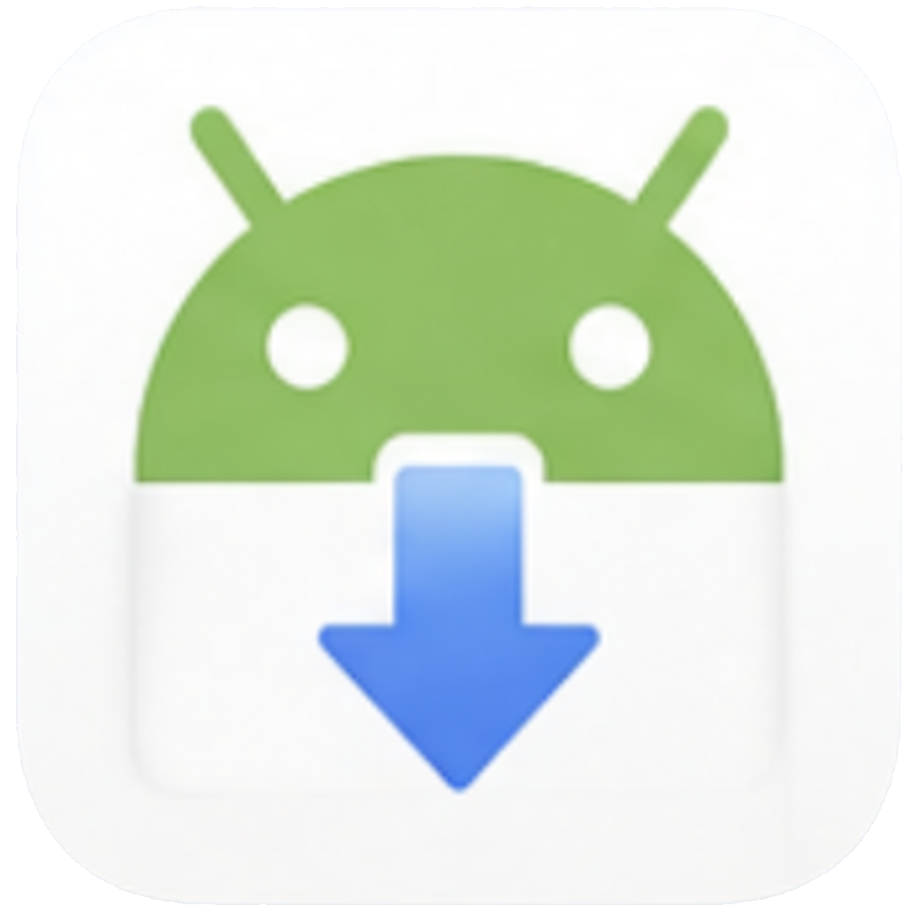

# Android Drop



Native macOS app (Cocoa/Objective-C) for dropping files onto an Android device over ADB.

Drag files or folders into the app window — they get pushed to the connected Android device via `adb push`. No iTunes-style client, no Android File Transfer — just a window and drag-n-drop.

## Features

- Drag-and-drop files and folders from Finder straight into the app window
- Automatic device detection (polls `adb devices`)
- Browse button to pick and inspect the destination folder on the device
- Paths are passed to `adb shell` as a single quoted command — spaces, Unicode, parentheses and other punctuation are handled correctly
- Folder-creation errors show the actual ADB output instead of a generic message
- Activity log written to `~/Library/Logs/AndroidDrop.log`

## Requirements

- macOS 12.0 (Monterey) or later
- Xcode Command Line Tools (to build from source)
- [Android Platform Tools (adb)](https://developer.android.com/tools/releases/platform-tools) — the app looks for `adb` in order at:
  1. `/opt/homebrew/bin/adb`
  2. `/usr/local/bin/adb`
  3. `~/Library/Android/sdk/platform-tools/adb`
  4. `/usr/bin/adb`
  5. `adb` on `$PATH`

Easiest way to install adb via Homebrew:

```bash
brew install android-platform-tools
```

- On the Android device, **USB debugging** must be enabled (Settings → Developer options → USB debugging), the device must be connected over USB (or Wi-Fi ADB) and authorized.

## Build

```bash
git clone git@github.com:Kreal-exe/AndroidDrop.git
cd AndroidDrop
./build.command
```

The script builds `Android Drop.app` in the repo root (the icon is generated from `AndroidDropIcon.png`). Drag the resulting app into `/Applications`.

Or grab a prebuilt binary from [Releases](../../releases) — no Xcode required.

## Usage

1. Launch `Android Drop.app`.
2. Connect the Android device over USB and authorize debugging.
3. Wait for the app to detect the device.
4. Optionally click **Browse** to pick a destination folder on the device, or type a path manually.
5. Drag files or folders into the window — the transfer starts automatically.

If something goes wrong, check `~/Library/Logs/AndroidDrop.log`.

## License

[MIT](LICENSE)
